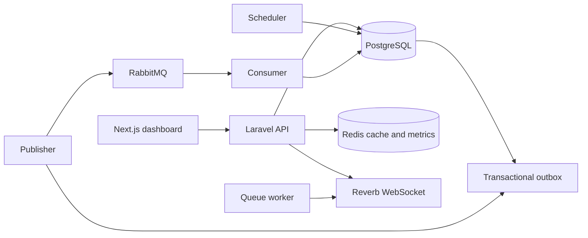
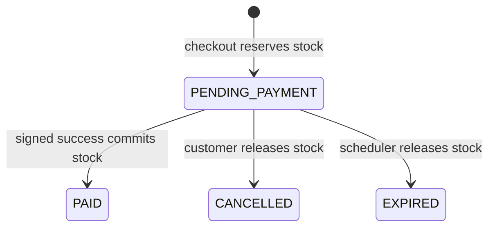

# OrderForge

OrderForge is a portfolio order and inventory system demonstrating concurrent checkout without overselling, idempotent payment callbacks, and recoverable asynchronous delivery. The mock payment provider needs no external account.

## Architecture



Stack: Laravel 13/PHP 8.4, Sanctum, PostgreSQL 17, Redis 7, RabbitMQ 4, Reverb, Next.js 16/React 19/TypeScript, Docker Compose. The API owns business state; the browser connects to host ports and containers connect by service name.

## Start locally

Run Docker Desktop, then from the repository root:

```bash
cp .env.example .env
docker compose up --build -d
docker compose exec app php artisan db:seed --force
docker compose ps
```

First boot installs PHP dependencies, creates an app key in backend/.env, and migrates. Open the [dashboard](http://localhost:3000), [API](http://127.0.0.1:8000/api/v1), or [RabbitMQ console](http://localhost:15672). Reverb uses port 8085. RabbitMQ local credentials are `orderforge` / `orderforge-local`. Change the sample secrets before a shared deployment. `docker compose down` preserves data; `docker compose down -v` removes the database, broker, and Redis volumes.

The first frontend image build can take several minutes on a 4 GB Docker Desktop VM. Later starts reuse the built image.

Seeded users use password `OrderForgeLocal2026!` unless `ORDERFORGE_DEMO_PASSWORD` changes:

| Role | Email |
| --- | --- |
| Admin | admin@orderforge.test |
| Customer | customer1@orderforge.test |
| Customer | customer2@orderforge.test |

The idempotent local seed creates 20 products and Jakarta/Surabaya warehouses. `OF-KB-001` starts with exactly one unit in Jakarta and none in Surabaya. Root [.env.example](.env.example) configures host ports and shared secrets; [backend/.env.example](backend/.env.example) lists Laravel settings. Demo seeding runs only in local/testing.

## Five-minute demo

1. Sign in as customer1, add a product, and check out. The order is `PENDING_PAYMENT` and stock is reserved.
2. Create a payment and simulate success. The signed webhook marks the order `PAID`, commits stock, and broadcasts the status on a private WebSocket channel.
3. Sign in as admin to inspect stock, payments, orders, outbox, dead letters, and failed queue jobs.
4. On a fresh seed, run `python3 scripts/concurrency_demo.py`. It sends 20 concurrent checkouts for the one keyboard; one succeeds and 19 get insufficient stock. The script cancels the winner to restore availability.
5. Use `{"duplicate_deliveries":5}` on the mock success endpoint to demonstrate webhook deduplication.

For expiration, create an unpaid order, wait past the default 15-minute window, then run `docker compose exec app php artisan orders:expire`. For broker recovery, stop only RabbitMQ, create an order, inspect the pending outbox row, restart it, then run `docker compose exec app php artisan outbox:publish` and `docker compose exec app php artisan events:consume --once`. See [docs/demo.md](docs/demo.md) for commands and capture points.

Portfolio captures: [customer paid order](docs/screenshots/customer-paid-order.jpg), [admin overview](docs/screenshots/admin-overview.jpg), and [event pipeline](docs/screenshots/admin-event-pipeline.jpg).

## Model and invariants

Products and warehouses identify stock. `inventories` stores on-hand and reserved quantities; `inventory_movements` is the ledger. `orders` contain immutable product/price snapshots in `order_items`, with `stock_reservations` tracking allocation. `payments` and `payment_webhooks` track provider state and delivery IDs. `idempotency_keys`, `outbox_events`, `processed_events`, `dead_letters`, and `audit_logs` support retries and tracing.



Payment moves from `PENDING` to `SUCCEEDED`, `FAILED`, or `EXPIRED`. A failed payment leaves the order pending until cancellation/expiry and never consumes stock. PostgreSQL row locks serialize inventory updates; availability is `on_hand - reserved`. Database constraints provide a second guard. Cancellation and expiration release each reservation once.

Checkout and payment creation require an `Idempotency-Key` UUID. The customer, request fingerprint, response, and expiry are stored. A repeated key/payload replays the response; different payload returns `409 IDEMPOTENCY_CONFLICT`. Webhook event IDs are unique, so duplicate delivery cannot repeat payment or inventory effects.

Business changes and outbox rows commit together. The publisher claims rows and retries with backoff; RabbitMQ carries persistent integration events. The consumer stores unique receipts in `processed_events`. Management API reads acknowledge before the database receipt commits, so old published outbox rows without receipts are automatically republished. Consumers are idempotent. Malformed events appear in `dead_letters` for admin retry.

## API and observability

The [OpenAPI specification](docs/openapi.yaml) includes request/response schemas, authentication, idempotency, examples, and errors. All business routes use `/api/v1`:

| Area | Routes |
| --- | --- |
| Auth/catalog | `POST /auth/register`, `POST /auth/login`, `GET /auth/me`, `POST /auth/logout`, `GET /products`, `GET /products/{id}` |
| Orders/payments | `GET /orders`, `POST /orders`, `GET /orders/{id}`, `POST /orders/{id}/cancel`, `POST /orders/{id}/payments`, `POST /payments/{id}/mock-success`, `POST /payments/{id}/mock-failure`, `POST /payments/{id}/mock-timeout`, `POST /payments/webhook/mock` |
| Admin | `GET /admin/inventory`, `POST /admin/inventory/{id}/adjustments`, `GET /admin/orders`, `GET /admin/payments`, `GET /admin/outbox`, `GET /admin/dead-letters`, `POST /admin/dead-letters/{id}/retry`, `GET /admin/failed-jobs` |

Mock simulation endpoints work only in local/testing. Admin endpoints require an admin token. Customer order reads and private WebSocket subscriptions require ownership; admins can inspect order channels. Raw webhooks require timestamp and HMAC signature headers.

`GET /health/live` checks the process; `GET /health/ready` checks PostgreSQL, Redis, RabbitMQ, and Reverb. `GET /metrics` serves Prometheus text for HTTP counts/latency, orders, failed payments, reservation failures, queue jobs, and dead letters. JSON logs on stderr include `X-Request-ID`, also returned by API responses. Inspect with `docker compose logs app worker events scheduler`.

## Verification

```bash
cd backend && php artisan test --compact && vendor/bin/pint --test && vendor/bin/phpstan analyse --no-progress --memory-limit=512M
cd ../frontend && npm ci && npm run lint && npm run build
cd .. && python3 scripts/concurrency_demo.py
```

CI runs backend tests, formatting/static analysis, and frontend lint/build. Feature tests cover inventory, checkout/idempotency, webhook deduplication, expiration, outbox retry/dead letters, and channel authorization. The concurrency script verifies PostgreSQL locking over real HTTP, beyond SQLite feature tests.

## Decisions and next steps

PostgreSQL owns stock correctness; Redis is only a cache and metric store. The Management API keeps broker integration compact, with reconciliation trading extra duplicate delivery for crash recovery. The payment provider is a reproducible mock. For production, add TLS, secret management, Prometheus/Grafana, tracing, AMQP manual acknowledgements, and more warehouse allocation policies. The original requirements are in [OrderForge_PRD.md](OrderForge_PRD.md). See [performance evidence](docs/performance.md) and the [local security review](docs/security-review.md).
