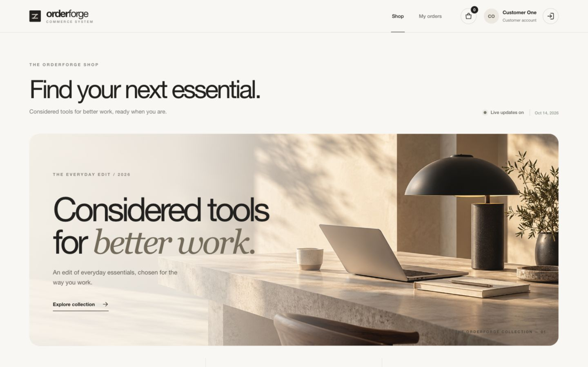
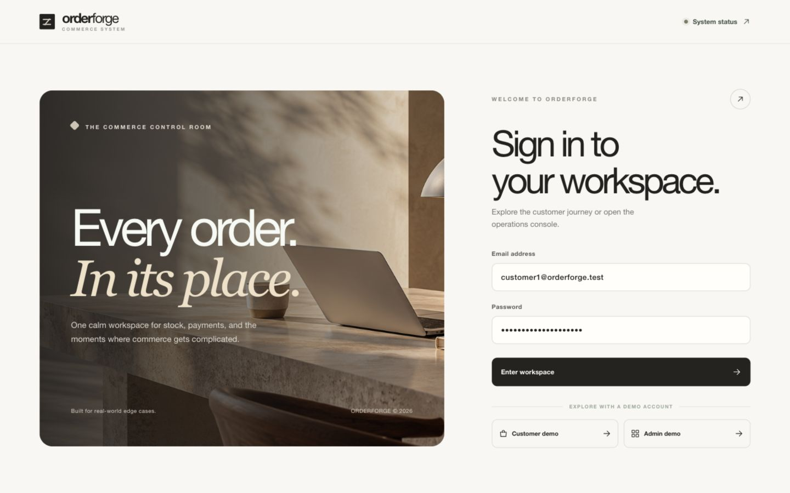
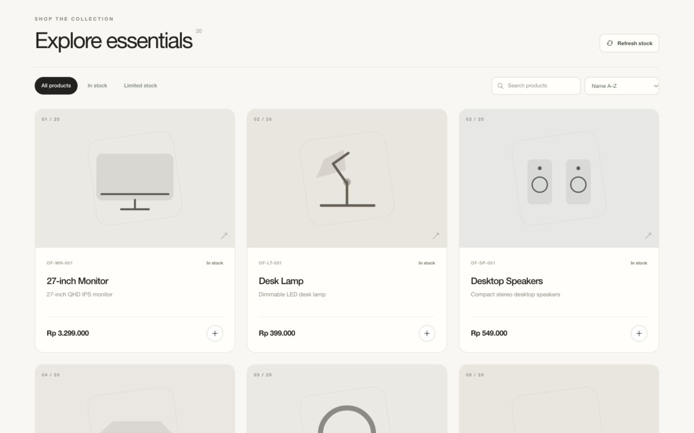
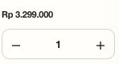
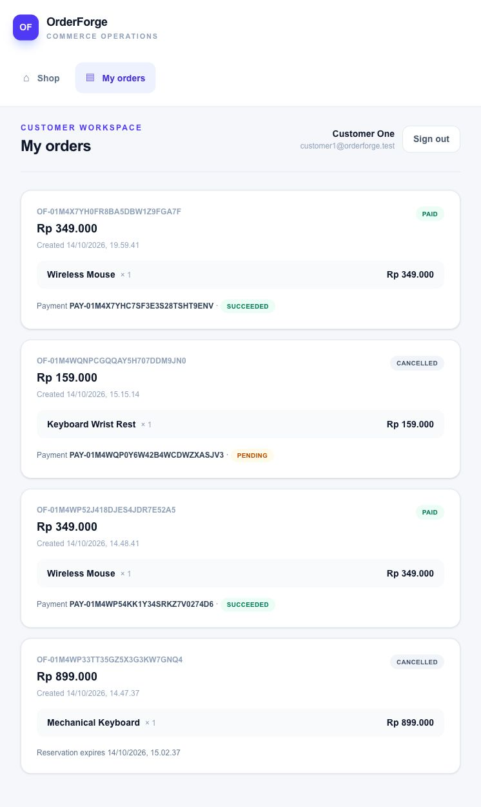
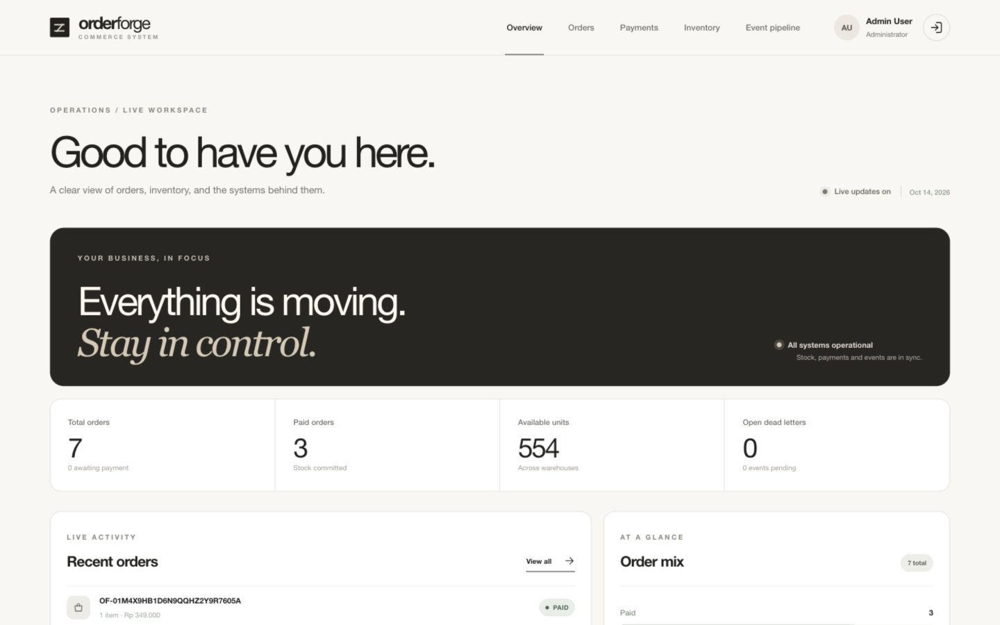
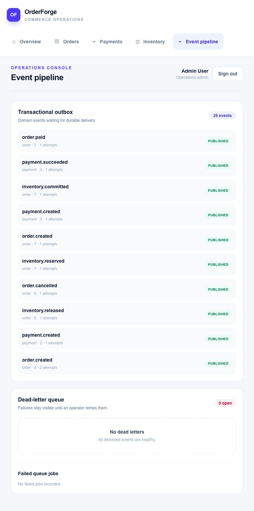
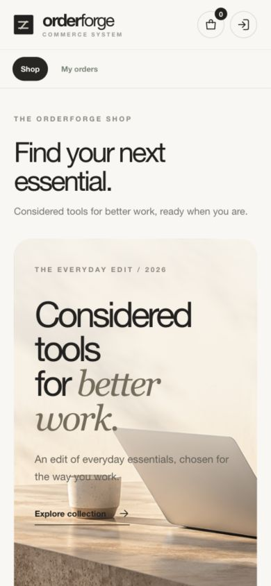
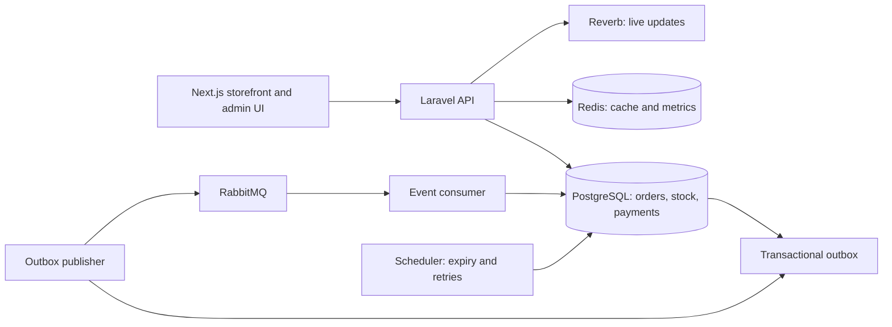
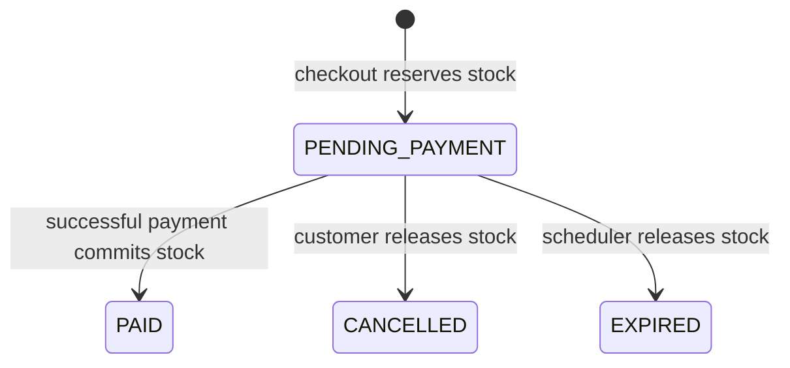

# OrderForge

**A commerce operations demo built to show what happens after the Checkout button.** Customers browse a curated catalog, reserve stock, and complete a mock payment. Admins follow orders, warehouse inventory, payments, and event delivery from one dashboard. The project demonstrates safe concurrent checkout, idempotent payments, and recovery when background delivery fails.



## Explore the demo

**1. Enter the workspace.** Choose the Customer or Admin demo profile on the sign-in screen. Both lead to role-specific views.



**2. Build an order.** Search, filter, and sort the catalog. Each product starts with a round **+** button. Press it once to add one item and reveal the `− 1 +` quantity control. Reducing the quantity to zero restores the round button; the plus button stops at available stock. The bag shows your selected items and subtotal before checkout.



Quantity control after adding an item, shown from a product card on mobile:



**3. Complete the mock payment.** Checkout reserves stock and creates a pending payment. In **My orders**, open the order and simulate success, failure, or timeout. A successful payment changes the order to `PAID` and consumes its reservation once.



**4. Monitor operations.** The admin overview summarizes order status and available stock. The event pipeline shows published outbox events, dead letters requiring review, and failed queue jobs.

<table>
  <tr><th>Admin overview</th><th>Event delivery and recovery</th></tr>
  <tr>
    <td></td>
    <td></td>
  </tr>
</table>

**5. Use it on a phone.** The catalog adapts to a narrow screen. The round add button changes to a full-width quantity control after the first tap.



## What is inside?

| Area | What you can do |
| --- | --- |
| Customer storefront | Search, filter, and sort 20 seeded products; change quantities directly on each card; review the bag; check out; inspect orders; simulate payment success, failure, or timeout; cancel an unpaid order. |
| Admin workspace | Review orders and payments, inspect two warehouses, record stock adjustments, watch the transactional outbox, and retry dead-letter events. |
| Reliability layer | Reserve stock inside PostgreSQL transactions, reject overselling, replay duplicate requests safely, deduplicate webhooks, publish events through RabbitMQ, and recover expired reservations. |
| Operations | Health and readiness endpoints, Prometheus metrics, structured request logs, queue worker, scheduler, and live updates via Reverb. |

The storefront is a **local portfolio demo**. Payments use a mock provider; there is no real charge, shipment, or external payment account.

## Demo accounts

The local seed creates **3 login accounts: 1 admin and 2 customers**. All three use the same initial password: **`OrderForgeLocal2026!`**.

| Role | Email | Purpose |
| --- | --- | --- |
| Admin | `admin@orderforge.test` | Manage inventory and inspect orders, payments, and event delivery. |
| Customer 1 | `customer1@orderforge.test` | Explore the storefront and place demo orders. |
| Customer 2 | `customer2@orderforge.test` | Place a second order, including the simultaneous-checkout demo. |

Set `ORDERFORGE_DEMO_PASSWORD` before **first** seeding to choose another password. Seeding again updates names and roles but **does not reset an existing user's password**. Demo seeding runs only in Laravel's `local` or `testing` environment. The worker, scheduler, and event consumer are services, not additional login accounts. Registration can create more customer accounts, so **3 is the seeded count**, not a permanent user limit.

## Run locally

Requirements: Docker Desktop and Docker Compose. From the repository root:

```bash
cp .env.example .env
docker compose up --build -d
docker compose exec app php artisan db:seed --force
docker compose ps
```

The first start installs PHP dependencies, generates the Laravel app key, and migrates the database. Open the [dashboard](http://localhost:3000) and sign in with an account above. The API is at `http://127.0.0.1:8000/api/v1`; its [readiness endpoint](http://127.0.0.1:8000/health/ready) checks PostgreSQL, Redis, RabbitMQ, and Reverb. The [RabbitMQ console](http://localhost:15672) uses `orderforge` / `orderforge-local` in the local Compose setup. Reverb listens on port 8085.

The first frontend image build can take several minutes on a small Docker VM. `docker compose down` preserves data. `docker compose down -v` removes the database, Redis, and broker volumes. See [.env.example](.env.example) and [backend/.env.example](backend/.env.example) for configuration.

## Try the main flow

1. Sign in as Customer 1, choose an in-stock product, add it to the bag, and select **Reserve & checkout**. Checkout creates an order and its pending mock payment session automatically. Stock is reserved; the order is `PENDING_PAYMENT`.
2. Open **Orders**, expand the order, and choose **Simulate success**. The signed local webhook changes the order to `PAID`, commits the reserved stock, and broadcasts the update. You can also try failure or timeout on a different pending order.
3. Sign in as Admin to inspect inventory, orders, payments, the outbox, and event recovery. Inventory adjustments create a ledger entry.
4. To show concurrent checkout, run `python3 scripts/concurrency_demo.py` while product `OF-KB-001` has exactly one available unit. Twenty requests race for it; one succeeds and 19 receive `INSUFFICIENT_STOCK`. The script cancels the winning order to restore its reservation.

The [demo runbook](docs/demo.md) includes expiration, broker recovery, and screenshot capture steps. The [OpenAPI specification](docs/openapi.yaml) documents requests, responses, authorization, and errors.

## How it works



**Stack:** Laravel 13 / PHP 8.4, Sanctum, PostgreSQL 17, Redis 7, RabbitMQ 4, Reverb, Next.js 16 / React 19 / TypeScript, and Docker Compose.

The database is the source of truth for stock. `inventories` stores on-hand and reserved quantities; availability is `on_hand - reserved`. Checkout locks inventory rows, records reservations and immutable order-item snapshots, then commits the order and outbox event together. Cancellation and expiration release reservations once. Payment success consumes stock once; duplicate webhook event IDs cannot repeat the effect. A payment failure leaves the reservation pending for cancellation or expiration.

Checkout and payment creation use an `Idempotency-Key` UUID. Repeating a key with the same payload replays the stored response; changing the payload returns `409 IDEMPOTENCY_CONFLICT`. Outbox events are retried with backoff, and the consumer records unique processing receipts. Malformed events go to dead letters for admin review and retry.



## API and checks

All business routes start with `/api/v1`. The main groups are auth and catalog (`/auth/*`, `/products`), customer orders and payments (`/orders`, `/payments/*`), and admin operations (`/admin/*`). Admin routes require an admin token; customers can read only their own orders. Mock payment simulation is available only in local/testing. Raw webhooks require timestamp and HMAC signature headers. Full contracts are in [docs/openapi.yaml](docs/openapi.yaml).

`GET /health/live` checks the process, `GET /health/ready` checks dependencies, and `GET /metrics` exposes Prometheus text. Application logs include an `X-Request-ID`. Inspect them with `docker compose logs app worker events scheduler`.

Run the backend checks in the app container and frontend checks from the frontend directory:

```bash
docker compose exec -T app php artisan test --compact
docker compose exec -T app vendor/bin/pint --test
docker compose exec -T app vendor/bin/phpstan analyse --no-progress --memory-limit=512M
cd frontend && npm run lint && npm run build
```

The feature suite covers inventory, checkout and idempotency, payment callbacks, expiration, outbox recovery, and access control. The concurrency script adds a real HTTP/PostgreSQL race check. See [performance evidence](docs/performance.md) and the [local security review](docs/security-review.md).

## Scope

This project is designed to demonstrate reliable order processing for a portfolio. The mock provider and local credentials make the flow reproducible without external services. A production deployment would need TLS, managed secrets, monitoring, tracing, and a real payment/shipping integration. The original requirements are in [OrderForge_PRD.md](OrderForge_PRD.md).
